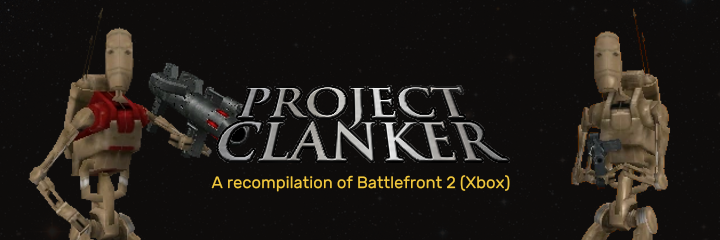

# project-clanker
A recompilation of Star Wars Battlefront II for the Xbox ported to PC



This repository builds a native Windows program that runs **Star Wars Battlefront II
(Xbox, 2005)** from your own copy of the game, with graphics through OpenGL and
controller input and audio through SDL2.

It contains no game code or assets. At startup it loads the original x86 machine
code from `src/rom/default.xbe` and runs it directly on the PC's CPU (the Xbox CPU is
a Pentium III, so no CPU emulation is involved). The Xbox platform underneath is
replaced by C++:

| Xbox component | Replaced by |
|---|---|
| `xboxkrnl.exe` (146 imported exports) | `src/runtime/kernel`: threads/TLS, dispatcher objects, DPCs, interrupts, files, memory |
| NV2A GPU (D3D8 talks to the hardware directly) | `src/runtime/gpu`: PFIFO/PGRAPH model, Kelvin → OpenGL (vertex programs and register combiners translated to GLSL) |
| USB input stack (XPP / XInput) | `src/runtime/hle/xinput.cpp` on top of SDL2 game controllers |
| MCPX audio processor (DirectSound) | `src/runtime/hle/dsound.cpp`: software mixer (PCM + Xbox ADPCM) on SDL2 audio |
| Xbox Live / networking | disabled (the game runs offline) |

Game code is then decompiled into C++ **incrementally** (`src/game`). Each
reconstructed function replaces its original through a hook, and everything not yet
decompiled keeps running from the XBE. The game is therefore playable at every step,
and any decompiled function can be compared against the original. This is the same
approach the re3/reVC projects used for GTA.

## Status

- Boots through the intro logos, title screen (with background movies), profile
  creation and every menu.
- The campaign's first level (Geonosis) loads and plays: 3D rendering with
  shadows, far-scene sky and haze, bloom, normal-mapped lighting, HUD,
  minimap, and weapons. Frames have been compared against xemu running the
  same disc and match closely. Other levels and modes haven't been tested yet.
- Runs at the game's native 30 fps.
- Controller input: any SDL2-supported controller, up to 4 players.
- Audio: sound effects and music, with voice headroom and positional (DS3D)
  panning. Levels have been compared against xemu.
- Saves (profiles) are written under `build/bin/<config>/userdata`.

Known gaps:

- No keyboard/mouse yet. The game expects a controller.
- Some GPU features are approximations: hardware lighting in the fixed-function
  path, signed texture formats, compressed volume textures, anti-aliasing
  modes, and the exact pixel-center convention.
- DSP audio effects (I3DL2 reverb, HRTF filtering) are not reproduced.
  Positional sounds are panned in stereo only.
- Online play and system link are disabled.
- Only one specific build of the game is supported (see below).
- Decompilation has just started (`src/game/input`).

## Building

Requirements: Windows 10/11 (64-bit), Visual Studio 2022 or 2026 with the C++
workload, CMake 3.21+, [vcpkg](https://github.com/microsoft/vcpkg), and a GPU with
OpenGL 4.3.

1. Copy your own dump of the game into `src/rom` (see `src/rom/README.md`). CMake
   verifies `default.xbe` against the supported build
   (SHA-1 `35ac5bd9ad3879f4a9c5eb5b306163e7b67f8964`) and refuses to configure
   without it.
2. Configure and build as a **32-bit** program, since the game code is 32-bit x86:

```bash
cmake -S src -B build -G "Visual Studio 18 2026" -A Win32 -DCMAKE_TOOLCHAIN_FILE=%VCPKG_ROOT%/scripts/buildsystems/vcpkg.cmake -DVCPKG_TARGET_TRIPLET=x86-windows-static
```

```bash
cmake --build build --config Release
```

   Alternatively, with `VCPKG_ROOT` set, run `cmake --preset win32` and then
   `cmake --build --preset release` from `src`. vcpkg installs SDL2 from
   `src/vcpkg.json`.
3. Run `build/bin/Release/swbf2.exe`. The game files are found through the path
   baked in at build time. Pass `--rom <dir>` or set `SWBF2_ROM` to use another
   location.

### Controls

Standard Xbox layout on any SDL2 game controller: A/B/X/Y, Black = right bumper,
White = left bumper, triggers, sticks (click = L3/R3), D-pad, Start, Back.
Alt+Enter toggles fullscreen.

### Command line

| Option | Effect |
|---|---|
| `--fullscreen` | start fullscreen |
| `--rom <dir>` | location of `default.xbe` and `Data/` |
| `--userdata <dir>` | where saves and the HDD partitions live |
| `--debug`, `--trace` | verbose logging to `swbf2.log` |
| `--shots` | write a PNG screenshot every 3 s (interval: `SWBF2_SHOT_INTERVAL`) |
| `--press "ms:button,..."` | scripted virtual controller for automated tests (`5000:start`, `8000:a`, `9000:ly+`, ...) |
| `--60fps` | runs the game at a higher max framerate |
| `--fullres` | runs the game at window resolution |

Debugging aids: F12 or Ctrl+Break dumps every thread's stack to the log.
`SWBF2_DUMP_AT=ms,...` does the same at fixed times, and `SWBF2_PROFILE_AT=start:duration`
runs a sampling profiler. Crash reports are symbolized with the function names in
`src/symbols/swbf2.sym`.

Renderer debugging: `SWBF2_CAPTURE_AT=ms` records one whole frame into
`capture_<pid>_<n>/`: the GPU state of every draw, clear and blit, each draw's
pixel coverage, the generated GLSL for every program, and optionally the
colour at a probe pixel (`SWBF2_CAPTURE_PROBE=x,y`) and PNGs of the render
target after chosen draws (`SWBF2_CAPTURE_SHOTS=a-b`). See
`src/runtime/gpu/capture.h` for the related switches.

## How it works

**Address space.** The XBE has no relocations and must sit at `0x00010000`. Windows
fills low memory before any program code runs, so `swbf2.exe`
(`src/loader/loader.c`) is a tiny CRT-less image linked at that address with a
64 MiB uninitialised section. It loads `swbf2rt.dll`, which copies the XBE sections
into that range. The XBE image header is relocated to `0x00D80000`, because
Windows still needs the EXE's own PE header at the image base. Xbox "physical"
memory (64 MiB) is a file mapping viewed at `0x80000000` and `0xF0000000`, and the
NV2A's PRAMIN window aliases its top megabyte.

**Hardware access.** D3D, DirectSound and the USB driver poke device registers
directly. Those MMIO windows are reserved no-access. A vectored exception handler
decodes each faulting instruction, performs the access against a device model, and
resumes. `in`/`out`/`cli`/`wbinvd` are emulated the same way.

**Threads.** Xbox code reads the Xbox KPCR through `fs:` and keeps TLS just below the
stack base. The 33 non-NT-compatible `fs:` accesses are patched to call stubs that
read a per-thread fake KPCR. Every Xbox thread runs on a stack the runtime
allocates, with the TEB stack bounds and a fresh SEH chain root, so native Windows
SEH and C++ exceptions work.

**GPU.** D3D builds NV2A push buffers. A pusher thread consumes them, binds objects
through RAMHT, raises the software-method, context-switch and vblank interrupts that
D3D's own ISR and DPC handle, and translates Kelvin state into OpenGL:

- NV2A vertex microcode is translated to GLSL.
- Register combiners and texture-shader stages become a GLSL fragment shader.
- Textures are unswizzled and decoded (including DXT, P8, cube and volume
  textures), and render targets live in GL textures keyed by guest address.
  A depth buffer sampled with a colour format is converted on the GPU into its
  raw memory bytes, which the game uses to blend its far scene and fog.
- Occlusion reports, flips and semaphores are emulated, along with the 2D blit
  engine.

**Clock.** XAPI's `QueryPerformanceCounter` reads `RDTSC` and assumes 733 MHz. It is
redirected to a correctly scaled counter; otherwise the whole game would run about
4× too fast on a modern CPU.

## Decompiling more of the game

Tools are in `src/tools`:

- `ghidra/ExportAll.java`: headless Ghidra export of every function (name, size,
  decompiled C). The XBE loader plugin
  [ghidra-xbe](https://github.com/XboxDev/ghidra-xbe) identifies XDK library
  functions.
- `ghidra/FsScan.java`, `HdrRefs.java`, `PrivScan.java`: the scans used to find
  the code sites the runtime patches.
- `gen_symbols.py`: regenerates `src/symbols/swbf2.sym` from the export.

To replace a function:

1. Write it in `src/game/...`, using `game::xbe_global<T>(addr)` for globals still in
   the XBE and `game::xbe_function<Fn>(addr)` to call code that isn't decompiled yet.
2. Register it with `HOOK(address, fn)` from `game::..._install_hooks()`, which
   `src/game/game.cpp` calls.
3. Ghidra marks register-argument (LTCG) functions; give those a small naked-asm
   entry stub that matches the original convention and preserved registers (see
   `src/game/input/pad.cpp`).
4. Use `rt::hook_detour()` when the original must still be callable, for example to
   compare outputs or to log calls.

## Legal

You must own the game to use this project. No copyrighted game code, data or assets
are distributed here. The repository contains only original source code, plus a
table of function names and addresses used to symbolize crash reports.


May the Force be with you.
